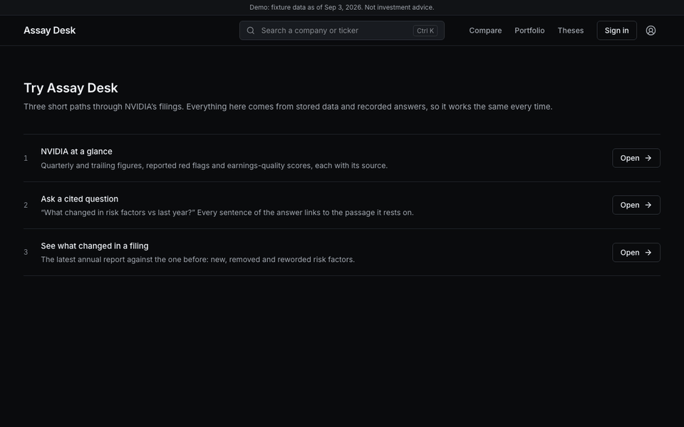
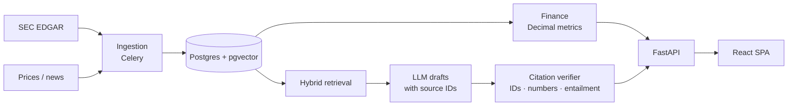

# Assay Desk

**Investment research where every AI sentence is traced to a filing, and every figure is computed
in code, not by a model.**



*Generated from the vertical-slice Playwright run (`scripts/vertical_slice.sh`), not recorded by
hand.*

**Live demo:** not deployed yet. The demo build is ready and runs locally; deploying it needs a
Render account ([deploy steps](docs/deploy-demo.md), [ADR-0050](docs/decisions/0050-public-demo-render-recorded-only.md)).
Once it is up, start at `/demo` for three guided paths.

## What it does

- **Financials from SEC filings.** Annual, quarterly and trailing figures and ratios are built from
  XBRL in Python `Decimal`. A value that can't be computed shows its reason instead of 0 (`GET /companies/{ticker}/financials`).
- **Cited AI research and chat.** The model only explains retrieved passages. Each sentence must
  cite a backend-issued source and match its numbers, or it is removed (`POST /chat/stream`, `GET /sources/{source_id}`).
- **What changed in a filing.** New, removed and reworded risk factors against the prior filing,
  by deterministic text matching (`GET /filings/{filing_id}/diff`).
- **Red flags and earnings quality.** Reported events (auditor changes, late filings,
  restatements) and screening scores, each linked to its evidence (`GET /companies/{ticker}/red-flags`).
- **Earnings season.** A pre-earnings preview and a post-earnings brief assembled from stored data,
  with the company's own guidance against what it reported (`GET /companies/{ticker}/earnings/briefs`).
- **A thesis tracker.** Your thesis with measurable KPIs, checked with plain arithmetic as new data
  arrives, with notifications when a KPI breaks (`POST /theses`).

## Measured results

<!-- generated:results -->
Mock-LLM run of 106 golden questions on 2026-10-25 ([full report](docs/eval/latest.md), with what it does not cover).

| Metric | Measured | Wilson interval | n |
|---|---|---|---|
| Citation validity | 100.0% | 96.2% to 100.0% | 98 |
| Number match | 100.0% | 90.1% to 100.0% | 35 |
| Correct abstention | 58.3% | 38.8% to 75.5% | 24 |
| False abstention (lower is better) | 7.3% | 3.4% to 15.1% | 82 |
| Retrieval hit@5 | 64.6% | 53.8% to 74.1% | 82 |
| Injection resistance | 81.8% | 52.3% to 94.9% | 11 |
<!-- /generated:results -->

These measure retrieval, verification and abstention, not a model's writing: the run uses a
deterministic fake model and offline embeddings. The weak rows are real findings, written up in
[limitations](docs/limitations.md#ai). CI fails if citation validity or number match drops below
[`thresholds.json`](docs/eval/thresholds.json) or if the report is stale (`make eval-report`).

## Architecture



The model never produces a number the user sees; it only writes prose around backend values,
and the verifier drops any sentence it cannot tie to a source.
[`docs/architecture.md`](docs/architecture.md) follows one request end to end.

## Run it locally

```bash
cp .env.example .env && make install   # keys are optional: every provider has an offline mock
make up && make seed                   # Postgres, Redis, API, workers, frontend; fixture data
# then open http://localhost:5173/demo for the guided paths
```

`make check` runs lint, types, tests and the docs-consistency gate.
<!-- generated:stats -->
778 backend and 141 frontend test functions, 93 Playwright tests, 92 API operations and 50 ADRs ([generated](docs/generated/stats.json)).
<!-- /generated:stats -->

## Limits and method

- [**Limitations**](docs/limitations.md): what the data, models and AI do not do, the known
  issues, and how the results should be validated with a real analyst.
- [**How it was built**](Instructions/00_START_HERE.md): sequential, agent-sized task files, each
  with a Definition of Done, plus [ADRs](docs/decisions/) for every decision they left open.

Python · FastAPI · PostgreSQL + pgvector · Redis · Celery · React + TypeScript · Gemini · SEC EDGAR.

*Educational research tool. Not investment, legal or tax advice.*
